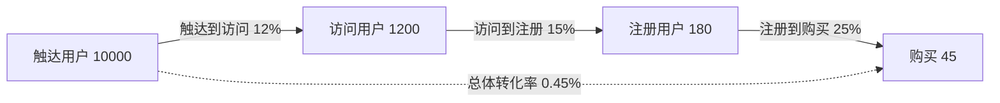
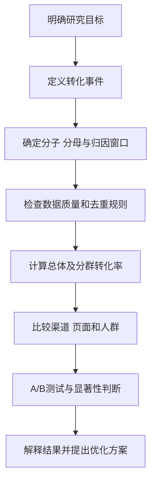

# 转化率

## 基本信息

- 姓名：刘静怡
- 学号：202513093069
- 名词：转化率（Conversion Rate，CVR）

## 一、定义

转化率是指在一定统计范围和时间内，完成预设目标行为的用户数或行为次数，占进入统计范围的用户数或行为次数的比例。目标行为可以是购买、注册、订阅、下载、填写问卷、报名活动或分享内容等。

$$
\text{转化率}=\frac{\text{完成目标行为的用户数或次数}}{\text{进入统计范围的用户数或次数}}\times100\%
$$

使用公式时必须同时说明转化事件、分子、分母和统计时间。例如，以独立访问用户数为分母得到用户转化率，以访问次数为分母得到会话转化率；两者的统计口径不同，不能直接比较。

## 二、背景和应用场景

转化率广泛用于数字营销、电子商务、传播效果评估、产品运营和公共传播。曝光量只能说明信息被看见的规模，点击量只能说明受众产生了进一步兴趣，而转化率关注受众是否完成了传播者预先设定的行动。

常见的转化事件包括：

- 电商：加入购物车、提交订单、完成支付；
- 内容平台：关注、订阅、收藏、评论或分享；
- 移动应用：安装、注册、首次使用或付费；
- 政务与公益：填写问卷、报名活动或完成捐赠。

转化率的价值不只在于给出一个百分比，还在于帮助研究者定位传播漏斗中的流失环节，并比较不同渠道、人群和页面方案的效果。

## 三、转化漏斗与图示

用户通常要经历“触达—访问—注册—购买”等连续阶段。为了保证分子和分母的统计单位一致，下面的漏斗以同一批可识别用户为观察对象，每名用户在每个阶段最多计数一次。每个阶段都可以计算阶段转化率，最终转化率则反映从入口到目标行为的整体效果。

图 1  转化漏斗示意图。每条箭头对应一个阶段转化率，虚线表示从曝光到购买的总体转化率。

阶段转化率的通用公式为：

$$
\text{阶段转化率}_i=\frac{N_{i+1}}{N_i}\times100\%
$$

其中，$N_i$ 表示进入第 $i$ 个阶段的去重用户数，$N_{i+1}$ 表示同一队列中进入下一阶段的去重用户数。漏斗分析比单独观察最终转化率更容易发现问题。

## 四、具体案例与计算

### 4.1 传播漏斗案例

某次传播活动在规定的归因窗口内触达了 10,000 名可识别用户。对同一批用户去重后，其中 1,200 名访问落地页，180 名完成注册，45 名完成购买。每名用户在每个阶段最多计数一次，因此各环节的分子和分母均为“去重用户数”。各环节的转化率为：

$$
\text{触达到访问转化率}=\frac{1200}{10000}\times100\%=12\%
$$

$$
\text{访问到注册转化率}=\frac{180}{1200}\times100\%=15\%
$$

$$
\text{注册到购买转化率}=\frac{45}{180}\times100\%=25\%
$$

$$
\text{触达到购买总体转化率}=\frac{45}{10000}\times100\%=0.45\%
$$

这个例子说明，最终转化率较低不一定意味着入口传播无效，也可能是注册或支付环节造成了较多流失。因此应按阶段诊断，而不是只看一个总体百分比。若无法把触达、访问和购买记录连接到同一批用户，就不应把事件次数与人数混合后解释为用户转化率；此时应统一采用事件次数口径，并明确其含义。

### 4.2 多渠道比较案例

下表假定统计期内的用户已按统一身份标识去重，并依据预先确定的归因规则划入 A、B、C 三个互斥渠道，即每名用户只进入一个渠道。若同一用户接触过多个渠道，应先采用固定的首次接触、末次接触或其他归因模型，不能在多个渠道中重复计数。

| 渠道 | 进入人数 | 完成目标人数 | 渠道转化率 |
| --- | ---: | ---: | ---: |
| A | 1,200 | 72 | 6% |
| B | 1,500 | 60 | 4% |
| C | 800 | 64 | 8% |
| 合计 | 3,500 | 196 | 5.6% |

渠道 A 的转化率为 72 / 1,200 = 6%。由于三个渠道互斥且用户已去重，总体转化率可以按人数加权计算：196 / 3,500 ≈ 5.6%。不能直接把三个渠道的百分比相加再除以 3，因为各渠道的进入人数不同。渠道 C 的转化率最高，但渠道 A 带来的转化人数更多，因此还需要结合渠道成本、用户质量和规模做判断。

## 五、与相关指标的对比

| 指标 | 计算方式 | 主要回答的问题 |
| --- | --- | --- |
| 点击率（CTR） | 点击次数 ÷ 曝光次数 | 内容是否吸引用户点击？ |
| 转化率（CVR） | 完成目标行为数 ÷ 进入统计范围的用户数或次数 | 用户是否完成预期行动？ |
| 跳出率 | 按分析产品及版本定义；例如 GA4 为未形成互动的会话占比 | 会话是否缺少有效互动？ |
| 留存率 | 观察期后仍活跃用户数 ÷ 初始用户数 | 用户是否持续使用？ |
| 收益指标 | 总收入 ÷ 订单数或用户数 | 转化之后产生了多少价值？ |

点击率高不一定代表转化率高。标题很吸引人可能带来大量点击，但如果落地页与标题不一致，用户仍可能不注册或不购买。转化率更接近目标行为，但也不能替代留存率和收益指标。

### 5.1 跳出率的产品版本差异

跳出率不是跨产品、跨版本完全统一的指标。Google Analytics 4（GA4）将跳出率定义为“未形成互动的会话占全部会话的百分比”，它是互动率的补集；互动会话需满足持续时间超过 10 秒、发生关键事件，或至少产生 2 次页面/屏幕浏览中的任一条件。Adobe Analytics 的 Bounce Rate 则按 Bounces ÷ Entries 计算，并受其变量和实现方式影响。因此，报告跳出率时必须同时注明分析产品、版本、会话定义和实现口径，不能笼统写成“单页会话数 ÷ 总会话数”。

## 六、转化率分析流程

图 2  转化率分析流程图。该流程强调先统一口径，再进行比较，避免把统计定义问题误判为传播效果差异。

### 6.1 统一统计口径

分子与分母必须属于同一时间范围和同一统计对象。若分子统计的是独立购买用户，分母也应尽量使用独立访问用户，而不能将用户数与访问次数混用。

### 6.2 区分人数和次数

同一用户可能多次访问、点击或下单。研究用户覆盖率时通常需要去重，研究页面或广告的行为次数时则可以使用次数口径。报告中应明确写出“人数”还是“次数”。

### 6.3 规定归因窗口

用户看到广告后可能不会立即购买，因此需要规定行为在多长时间内可以归因给该广告。例如，可以设置为点击后 7 天或曝光后 24 小时。不同归因窗口会导致不同的转化率，比较时必须保持一致。

## 七、A/B 测试与统计不确定性

设方案 A 的转化率为 p_A，方案 B 的转化率为 p_B，则 B 相对 A 的提升率为：

$$
\text{相对提升率}=\frac{p_B-p_A}{p_A}\times100\%
$$

例如，方案 A 为 4%，方案 B 为 5%，相对提升率为 25%，但绝对提升只有 1 个百分点，报告中应同时说明两种变化。

若样本量为 n，估计转化率为 p，标准误可近似表示为：

$$SE(p) = \sqrt{p(1-p)/n}$$

样本量较大时，约 95% 的置信区间可近似写为：

$$p \pm 1.96 \times SE(p)$$

因此，两个方案的百分比不同，并不自动意味着存在可靠的因果差异，还要检查样本量、置信区间和实验设计。

## 八、影响因素与局限

1. 短期转化上升不一定带来长期留存或更高收益。
2. 更换分母、去重规则或归因窗口会改变转化率。
3. 小样本中的少数转化事件可能造成百分比剧烈波动。
4. 相关关系不等于因果关系，渠道差异可能来自受众结构不同。
5. 总体平均值可能掩盖地区、设备和人群之间的差异。

## 九、简明总结

转化率是完成目标行为的用户数或次数与进入统计范围的用户数或次数之比。正确分析转化率需要先定义事件和统计口径，用转化漏斗定位流失环节，用加权总体转化率比较不同规模的渠道，并结合 A/B 测试、置信区间、留存和收益指标解释结果。

## 十、参考资料

1. Google Ads Help. [Conversion rate: Definition](https://support.google.com/google-ads/answer/2684489)（转化率的基本定义与计算口径）。
2. Google Analytics Help. [Bounce rate](https://support.google.com/analytics/answer/12195621)（GA4 跳出率、互动率及互动会话定义）。
3. Adobe Analytics Documentation. [Bounce rate](https://experienceleague.adobe.com/en/docs/analytics/components/metrics/bounce-rate)（Adobe Analytics 中 Bounce Rate 的定义和计算方式）。
4. Google Analytics Help. [Funnel exploration](https://support.google.com/analytics/answer/9327974)（漏斗探索与各步骤用户流失分析）。
5. Kohavi, R., Tang, D., & Xu, Y. (2020). *Trustworthy Online Controlled Experiments: A Practical Guide to A/B Testing*. Cambridge University Press.
