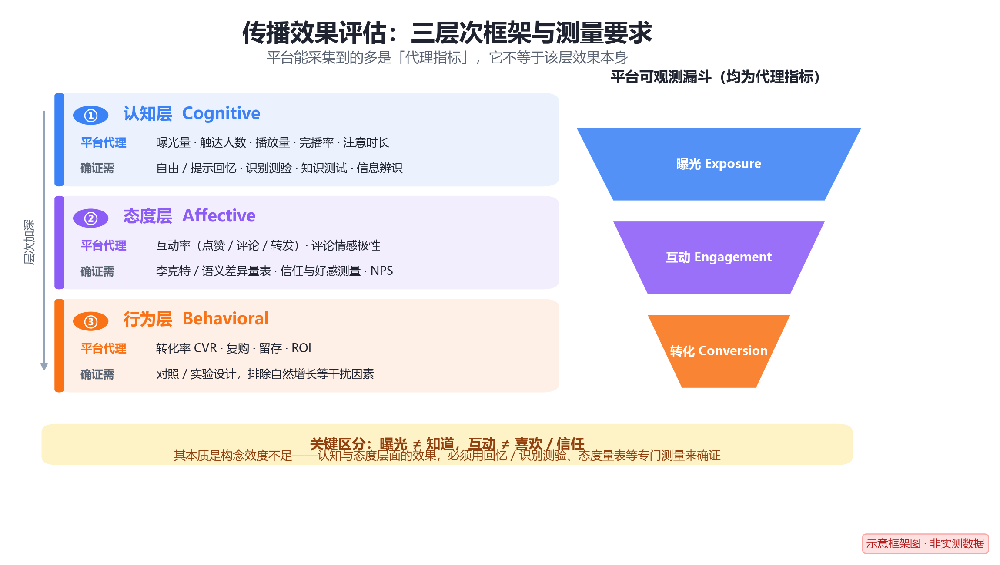
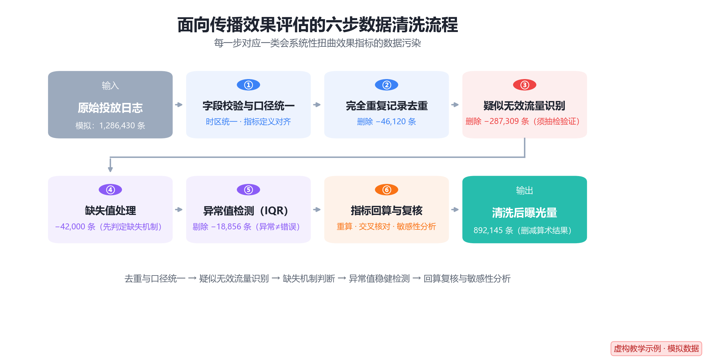
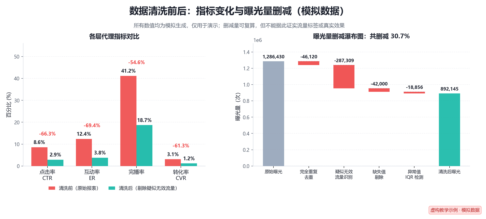

# 传播效果评估

## 基本信息

- 姓名：孙轼淇
- 学号：202513093019
- 名词：传播效果评估（Communication Effect Evaluation）
- 认领序号：70

**关键词**：传播效果评估、效果测量、指标体系、数据清洗、缺失机制、敏感性分析

> **阅读提示**：本文第四、六章涉及的具体数字均为**虚构教学示例的模拟数据**，用于演示方法，不对应任何真实机构或投放活动。详见第四章开头说明。

## 目录

- [基本信息](#基本信息)
- [一、定义](#一定义)
- [二、背景与上下文](#二背景与上下文)
  - [2.1 学术脉络：从"魔弹"到"可测量"](#21-学术脉络从魔弹到可测量)
  - [2.2 现代场景：从"媒介效果"到"数据效果"](#22-现代场景从媒介效果到数据效果)
  - [2.3 为什么数据清洗是评估的"第一道闸门"](#23-为什么数据清洗是评估的第一道闸门)
- [三、核心框架：三层次，"代理指标"不等于"效果"](#三核心框架三层次代理指标不等于效果)
  - [3.1 认知层（Cognitive）：曝光不等于"知道"](#31-认知层cognitive曝光不等于知道)
  - [3.2 态度层（Affective）：互动不等于"喜欢"或"信任"](#32-态度层affective互动不等于喜欢或信任)
  - [3.3 行为层（Behavioral）：可观测性最好，但仍需排除他因](#33-行为层behavioral可观测性最好但仍需排除他因)
  - [3.4 效度与信度：代理指标为什么会"失效"](#34-效度与信度代理指标为什么会失效)
  - [3.5 三层框架小结](#35-三层框架小结)
  - [3.6 常用指标与计算公式](#36-常用指标与计算公式)
  - [3.7 评估方法体系与标准流程](#37-评估方法体系与标准流程)
- [四、举例说明](#四举例说明)
  - [4.1 案例背景（模拟）](#41-案例背景模拟)
  - [4.2 数据清洗流程（六步）](#42-数据清洗流程六步)
  - [4.3 清洗前后的对比（模拟数据）](#43-清洗前后的对比模拟数据)
- [五、对比分析](#五对比分析)
- [六、深入扩展：数据清洗视角下的五个关键问题](#六深入扩展数据清洗视角下的五个关键问题)
  - [6.1 无效流量：效果评估的头号干扰](#61-无效流量效果评估的头号干扰)
  - [6.2 异常值检测：3σ 与 IQR 的取舍](#62-异常值检测3σ-与-iqr-的取舍)
  - [6.3 缺失值：先说清假设，再做敏感性分析](#63-缺失值先说清假设再做敏感性分析)
  - [6.4 辛普森悖论：分组能救命](#64-辛普森悖论分组能救命)
  - [6.5 效果是否显著：不要用"数字大小"下结论](#65-效果是否显著不要用数字大小下结论)
- [七、简明总结](#七简明总结)
- [参考文献](#参考文献)

---

## 一、定义

**传播效果评估（Communication Effect Evaluation / Measurement）**，是指运用系统的测量方法与数据手段，对传播活动（一条信息、一次投放、一场宣传活动）在受众身上实际产生的**影响及其程度**进行**量化描述与因果判断**的过程。

拆开来看，它包含三个不可省略的成分：

| 成分 | 含义 | 要回答的问题 |
| --- | --- | --- |
| **测量对象** | 受众的认知、态度与行为变化 | 变化发生在哪里？ |
| **测量手段** | 指标体系 + 统计模型 + 数据清洗 | 用什么数据、怎么算？ |
| **判断结论** | 效果大小、是否显著、是否由传播导致 | 变化是不是"传播带来的"？ |

如果只用一个式子概括传播效果评估的底层逻辑，它可以写成：

$$
\text{传播效果} = f\big(\mathbf{X}_{\text{传播刺激}},\ \mathbf{Z}_{\text{受众与情境}}\big) + \varepsilon
$$

其中 $\mathbf{X}$ 表示传播刺激（内容、渠道、频次、预算等），$\mathbf{Z}$ 表示受众特征与外部情境（人群结构、季节性、竞品动作等），$\varepsilon$ 为随机扰动。**评估的本质，就是从充满噪声的 $\varepsilon$ 中，把 $\mathbf{X}$ 的真实贡献分离出来。**

> **一句话版本**：传播效果评估，就是用可信的数据回答"这次传播到底有没有用、有多大用、为什么有用"。

---

## 二、背景与上下文

### 2.1 学术脉络：从"魔弹"到"可测量"

传播效果研究是传播学的核心命题之一，其理论认识经历了三次明显转向：

1. **强效果阶段（20 世纪初—1930s）**：以"魔弹论 / 皮下注射论"为代表，认为媒介信息对受众具有直接、强大、均质的刺激效果。
2. **有限效果阶段（1940s—1970s）**：拉扎斯菲尔德等人的伊里调查、霍夫兰的说服实验、卡兹的"使用与满足"研究，证明受众存在选择性接触与中介因素，效果是**有限且有条件**的。这一阶段最大的贡献是：**效果必须被经验地测量，而不能被想当然地假定。**
3. **适度效果与强大效果阶段（1970s 至今）**：议程设置、涵化理论、沉默的螺旋等表明，媒介的长期、累积、认知层面的效果依然强大。

每一次转向，都把"效果评估"从哲学思辨推向**实证测量**。

### 2.2 现代场景：从"媒介效果"到"数据效果"

进入平台化、算法化的传播环境后，效果评估的重心发生了两点变化：

- **评估对象变了**：从"大众媒介对社会的长期影响"，转向"单次内容投放的即时转化"。
- **评估依据变了**：从抽样问卷，转向**全量的平台行为日志**（曝光、点击、停留、互动、转化埋点）。

这使得传播效果评估成为**数据密集型的交叉工作**——它同时需要传播学的理论框架、统计学的因果推断工具，以及数据工程的数据质量保障。

### 2.3 为什么数据清洗是评估的"第一道闸门"

平台原始日志天然带有噪声，而效果指标几乎全是**比率型指标**，这类指标对分子分母的污染极为敏感：

- **分母被虚增**：曝光量中混入无效流量（爬虫、脚本、刷量曝光），会**压低**点击率、互动率等比率指标；
- **分子被虚增**：点击、互动中混入水军刷量，会**抬高**这些指标；
- **口径不一致**：时区错乱、重复上报、各平台"播放量／互动"定义不同，会同时污染分子与分母。

> 两类污染的方向可能相反、也可能叠加，**净影响取决于哪一侧被污染得更严重**。因此不能凭直觉断言"清洗一定会调高（或调低）指标"，必须实际清洗后复算——这正是本文要花大量篇幅讨论清洗的原因。

---

## 三、核心框架：三层次，"代理指标"不等于"效果"

传播学普遍采用的效果分解，是按受众反应的深度划为三个层次——**认知层 → 态度层 → 行为层**（CAB 模型：Cognition–Affect–Behavior）。层次越深，评估难度越大，商业价值通常也越高。

但这里有一个**必须首先澄清的关键点**：平台能直接采集到的数据（曝光、触达、完播、互动、转化）绝大多数是**接触与行为痕迹**，它们只是各层效果的**代理指标（proxy）**，而**不是该层效果的证明**。

*图 1　传播效果评估的三层次框架：左侧三层次分别列出"平台代理"指标与"确证需"的专门测量方法；右侧为平台可观测漏斗。本图为示意框架图，不含实测数据。*

### 3.1 认知层（Cognitive）：曝光不等于"知道"

- **理论上要测量的是**：受众是否**记住并理解**了信息——自由回忆、提示回忆、识别测验、知识测试、信息辨识度。
- **平台常见的代理指标**：曝光量（Impressions）、触达人数（Reach / UV）、播放量、完播率、注意时长（Dwell Time）。
- **代理的局限**：
  - **曝光只表示内容被投送／被展示**，不表示被看到——这正是广告业提出"可见曝光（viewable impression）"标准的原因；
  - 即便被看到，也不表示被**记住**或**理解**；
  - **完播率**只说明内容被播放完，不说明内容被接受或形成记忆。

> 因此，**"曝光量高"不能写成"受众知道了"**。若研究问题确实指向认知效果，必须补充回忆／识别／知识测验等直接测量。

### 3.2 态度层（Affective）：互动不等于"喜欢"或"信任"

- **理论上要测量的是**：评价倾向与情感变化——李克特量表、语义差异量表、信任量表、好感度、NPS 净推荐值，以及基于文本的情感倾向编码。
- **平台常见的代理指标**：互动率（点赞、评论、转发、收藏）、评论情感极性。
- **代理的局限**：互动首先是一种**行为**，不是态度。
  - **点赞可能是社交礼节或顺手行为**，行为成本极低，不构成"喜欢"的证据；
  - **转发可能出于吐槽、围观或站队**，情绪方向未必正面；
  - **评论可能是负面表达**，高互动甚至可能对应负面事件；
  - 用文本情感分析推断态度，还面临反讽、语境缺失、样本自选择（往往只有极端者才发声）等系统误差。

> 因此，**"互动率高"不能写成"受众喜欢／信任"**。态度层面需要专门的态度测量工具，并注意社会赞许性偏差。

### 3.3 行为层（Behavioral）：可观测性最好，但仍需排除他因

- **理论上要测量的是**：受众是否发生目标行动——下单、注册、报名、到店、复购、留存。
- **平台常见的代理指标**：转化率（CVR）、投入产出比（ROI）、留存率与复购率。
- **代理的局限**：行为指标可观测性最好、最接近"效果"本身，但**相关不等于因果**。没有对照组时，无法区分"传播带来的转化"与"本来就会发生的自然转化"（参见 3.6 节的净效果与 6.5 节的因果设计）。

### 3.4 效度与信度：代理指标为什么会"失效"

代理指标的失效，在测量学上有明确的名字——**构念效度（construct validity）不足**。

- **构念效度**：测量工具是否真的测到了它声称要测的那个概念。用"曝光量"去论证"认知效果"，就是用一个"接触"指标去代表"记忆与理解"这个构念，二者之间隔着"是否看到""是否注意""是否记住"多道关卡。**构念效度不足，是传播效果评估中最常见的系统性缺陷。**
- **内部效度**：结论能否被合理地归因于传播刺激本身，而非自然增长、季节性、同期促销等干扰。这需要 6.5 节的对照／因果设计来保障。
- **外部效度**：结论能否推广到其他人群、平台与时段。一次投放的效果不能自动外推到所有场景。
- **信度**：重复测量是否稳定一致。情感分析模型、无效流量识别规则若在不同批次上给出波动极大的结果，就说明信度不足，其结论同样不可用。

一句话概括：**层级越深，构念效度越难保证，"用一个便宜指标代替一个昂贵构念"的风险越大。** 这也解释了本文反复强调的一点——代理指标可用于**监测与预警**，但若要用于**结论与决策**，就必须先回答它的效度与信度问题。

### 3.5 三层框架小结

| 层次 | 理论上应测量什么 | 平台常见代理指标 | 代理的关键局限 |
| --- | --- | --- | --- |
| **认知层** | 回忆、识别、知识测验、理解度 | 曝光、触达、播放量、完播率、注意时长 | 展示 ≠ 看到 ≠ 记住 |
| **态度层** | 态度量表、信任／好感、情感倾向 | 互动率、评论情感极性 | 互动是行为，可能是礼节、围观或负面表达 |
| **行为层** | 目标行为发生率及其因果归因 | 转化率、ROI、复购、留存 | 无对照则混淆自然增长等干扰 |

### 3.6 常用指标与计算公式

**基础比率指标**（注意：它们都只是代理指标）

$$
CTR = \frac{\text{Clicks}}{\text{Impressions}} \times 100\%
$$

$$
ER = \frac{\text{Likes} + \text{Comments} + \text{Shares}}{\text{Reach}} \times 100\%
$$

$$
CVR = \frac{\text{Conversions}}{\text{Clicks}} \times 100\%
$$

$$
CPM = \frac{\text{Cost}}{\text{Impressions}} \times 1000
$$

$$
ROI = \frac{\text{Revenue} - \text{Cost}}{\text{Cost}} \times 100\%
$$

**多指标合成效果指数**

单一指标无法刻画完整效果，实践中常做无量纲化后加权合成。先做极差标准化：

$$
\tilde{x}_i = \frac{x_i - \min(x)}{\max(x) - \min(x)}
$$

再按权重合成综合效果指数：

$$
E = \sum_{i=1}^{n} w_i \cdot \tilde{x}_i,\qquad \sum_{i=1}^{n} w_i = 1,\ w_i \ge 0
$$

权重 $w_i$ 通常由层次分析法（AHP）、熵权法或业务经验确定。**需要提醒的是**：加权合成的只是**代理指标**的综合，权重选择本身带有主观性，合成结果仍需与专门测量相互印证。

**净效果（剔除自然增长）**

传播效果必须扣除"没有传播也会发生的部分"，否则会把自然增长误记为传播功劳：

$$
\text{净效果} = Y_{\text{实验组}} - Y_{\text{对照组}}
$$

### 3.7 评估方法体系与标准流程

**四类常用方法及其效度取舍**

| 方法 | 能测到什么 | 内部效度 | 外部效度 | 主要局限 |
| --- | --- | --- | --- | --- |
| 受控实验／A/B 测试 | 因果效应（净效果） | **强** | 弱 | 场景受限、成本高，可能存在实验效应 |
| 抽样调查 + 量表 | 认知、态度、"使用与满足" | 中 | **强** | 自我报告偏差、社会赞许性、回忆误差 |
| 内容分析 | 信息本身的特征与框架 | — | — | 只测"传了什么"，不测"受众变了什么" |
| 平台日志分析 | 大规模的接触与行为痕迹 | 弱 | 中 | **全部是代理指标**，且易被无效流量污染 |

**标准流程（七步）**

1. **明确目标与效果层次**：这次评估要回答的是认知、态度还是行为层的问题？
2. **选择测量方法**：按上表权衡内部效度、外部效度与成本。
3. **设计指标与口径**：定义分子、分母、时间窗与去重规则，并留下可复算的口径文档。
4. **数据采集**：日志、问卷、实验分组，同时记录采集过程中已知的缺陷。
5. **数据清洗与质量核验**：即本文第四章的六步流程——去重、疑似无效流量识别、缺失与异常处理、回算复核。
6. **统计分析与因果推断**：显著性检验、净效果估计、DID／实验设计（6.5 节）。
7. **结论与敏感性报告**：不仅给出点估计，还要说明假设、给出区间，并交代结论的稳健性。

> **注意第 5 步的位置**：清洗夹在"采集"与"分析"之间，看起来只是一个中间环节，却决定了后面两步的**全部结论是否有意义**。清洗做错，第 6、7 步只是把错误算得更精确而已。更何况，清洗涉及的每一个判断（哪条算疑似无效流量、缺失属于哪种机制）本身都是**假设**，都必须在报告中被交代和检验。

---

## 四、举例说明

> ⚠️ **本案例为虚构教学示例。** 以下所有数字均为**模拟生成**，不对应任何真实城市、机构或投放活动，仅用于演示数据清洗的流程与方法要点。**案例中出现的"疑似无效流量"标签与"清洗后"数值，均不构成对任何真实流量真实性的判断，也不构成本案例真实效果的证据。**

### 4.1 案例背景（模拟）

假设某文旅类账号在短视频平台投放宣传片，为期 7 天。此处**设定**平台方提供的原始报表显示：曝光 1,286,430，点击率 8.6%，互动率 12.4%。

再**假设**运营团队完整走了一遍数据清洗流程，得到的清洗后曝光为 892,145、点击率 2.9%、互动率 3.8%。

下面用这组模拟数据演示清洗流程。**重点不在数字本身，而在于每一步做了什么判断、依据什么假设，以及这些假设需要怎样被检验。**

### 4.2 数据清洗流程（六步）

*图 2　面向传播效果评估的六步数据清洗流程（虚构教学示例·模拟数据）：每一步对应一类会扭曲效果指标的数据污染。*

**第 1 步：字段校验与口径统一**

统一时间戳时区（全部转为 UTC+8）、统一各平台"播放量""互动"的定义边界。若口径不一致，跨平台指标不可加、不可比。

**第 2 步：完全重复记录去重**

同一条 `用户ID + 内容ID + 时间戳` 出现多次，多为日志重复上报。本例（模拟）删除 **46,120** 条。

**第 3 步：疑似无效流量识别**

采用组合规则与统计特征识别可疑流量：

- **频次异常**：同一设备 24 小时内曝光 > 200 次
- **时间规律异常**：行为间隔的标准差 < 0.5 秒（机器定时脚本特征）
- **身份异常**：User-Agent 缺失或异常、设备指纹雷同、注册时间集中在极短窗口
- **行为链异常**：只曝光不滚动、只点赞不阅读、互动高度集中于少数账号

本例（模拟）据此删除 **287,309** 条。

> ⚠️ **重要限定（必须说清）**：这些记录只能是**"疑似无效流量"**，识别规则给出的是**分类判断**，不是事实认定：
> 1. 规则必然同时存在**误判**（把真人判成机器）与**漏判**（把机器判成真人）。要评估其可靠性，必须**人工抽检**被标记与被保留的样本，估计**精确率与召回率**，并据此给出净误判量的上下界。
> 2. 阈值（如"24 小时曝光 > 200 次"）是**人为选择**，改变阈值会改变删减量。因此应报告**不同阈值下的结果区间**，而不是只报一个数。
> 3. **删除疑似无效流量 ≠ 得到"真实效果"**：它只修正了"流量有效性"这一层，真实效果仍需 3.6 节的净效果口径与 6.5 节的对照／因果设计来确认。

**第 4 步：缺失值处理**

在剔除疑似无效流量后剩余的 953,001 条记录中，"曝光时长"字段缺失 **42,000** 条（约 4.4%）。**处理方式完全取决于缺失机制，不能一律用中位数插补**（详见 6.3 节）：

- **MCAR（完全随机缺失）**：缺失与任何变量无关 → 完整案例分析（删除缺失行）在估计上无偏，但损失样本量、降低检验效能；此时均值／中位数插补仅可用于粗略描述统计（会压缩方差）。
- **MAR（随机缺失）**：缺失可由已观测变量解释 → 应使用**基于条件分布的插补**，如回归插补、**多重插补（MICE）**，并保留插补间方差。**中位数插补不适用于 MAR 数据**——它忽略条件信息，会压缩方差、低估标准误。
- **MNAR（非随机缺失）**：缺失取决于未观测的缺失值本身 → **常规多重插补（MICE）的标准假定不成立**（其实现通常假定 MAR）。此时须借助选择模型（如 Heckman）、模式混合模型，或**敏感性分析**。

**敏感性分析的做法**：设定不同的缺失假设（例如缺失者的真实停留时长比可观测者系统性低 $\delta$ 秒，让 $\delta$ 取多个值），或采用不同的插补策略，观察核心结论是否改变，并报告结论区间，说明"结论在何种假设下才成立"。

本例（模拟）中，这 **42,000** 条记录不参与指标计算，同时单独报告其规模，并给出方向性判断：若这些记录的停留时长系统性偏短，则真实完播率应低于报告值。

**第 5 步：异常值检测（IQR）**

对"停留时长"等连续变量采用四分位距法：

$$
IQR = Q_3 - Q_1,\qquad \text{下界} = Q_1 - 1.5\,IQR,\qquad \text{上界} = Q_3 + 1.5\,IQR
$$

超出上下界的记录标记为异常，本例（模拟）据此剔除 **18,856** 条。**注意：异常值不等于错误值**——"超长停留"可能是真实的高黏性用户，需结合业务判断是剔除、截尾（Winsorize）还是保留。

**第 6 步：指标回算与复核**

用清洗后的数据重算全部指标，并与清洗前对比、与业务方交叉验证。**复核的重点不是"数字对不对"，而是"口径与假设是否被清楚交代"**：删减规则、阈值、缺失假设、异常判定标准都应写入报告，以便他人复算与质疑。

### 4.3 清洗前后的对比（模拟数据）

| 指标 | 清洗前（原始报表） | 清洗后（剔除疑似无效流量后） | 相对偏差 |
| --- | ---: | ---: | ---: |
| 曝光量 | 1,286,430 | 892,145 | −30.7% |
| 点击率 CTR | 8.6% | 2.9% | −66.3% |
| 互动率 ER | 12.4% | 3.8% | −69.4% |
| 完播率 | 41.2% | 18.7% | −54.6% |
| 转化率 CVR | 3.1% | 1.2% | −61.3% |

*图 3　虚构教学示例（模拟数据）：左为各层代理指标在清洗前后的对比，右为曝光量删减瀑布图。*

**关于 892,145 这个数字，必须说清三件事：**

1. **它只是算术结果。** $1{,}286{,}430 - 46{,}120 - 287{,}309 - 42{,}000 - 18{,}856 = 892{,}145$，即"原始量减去各项删减量"。它能被复算，**但复算成立不等于事实成立**。
2. **它不能证明被删的 287,309 条"就是机器人"。** 那只是按预设规则作出的**疑似**判定，误判与漏判同时存在，必须经人工抽检验证（见第 3 步的限定）。
3. **它也不能证明剩下的就是"真实效果"。** 剔除疑似无效流量只解决了"分母干不干净"，没有解决"变化是不是传播造成的"——后者需要对照设计。

因此，本案例能够说明的只是：**同一批日志，在不同的口径与假设下会给出差异极大的指标，甚至相反的行动建议，所以口径与假设必须显式交代、并接受敏感性检验。** 这也正是本节作为"虚构教学示例"的边界所在。

---

## 五、对比分析

传播效果评估常与几个邻近概念混淆，下表做一辨析。

| 维度 | **传播效果评估** | **传播过程评估** | **舆情监测** | **转化归因分析** |
| --- | --- | --- | --- | --- |
| **关注焦点** | 结果：受众发生了什么变化 | 过程：执行是否到位 | 状态：舆论场在说什么 | 分配：功劳归于哪个触点 |
| **核心问题** | 有没有用？多大用？ | 做得对不对？ | 现在什么情况？ | 该记谁的功？ |
| **典型指标** | CTR、ER、CVR、ROI、净效果 | 发布量、覆盖渠道、发布时间合规性 | 声量、情感极性、热点演化 | 末次点击、线性、Shapley 值 |
| **时间取向** | 事后（亦可实时） | 事中 | 实时 | 事后 |
| **数据依赖** | 行为日志 + 对照组 | 执行台账 | 文本语料 | 多触点链路日志 |
| **主要方法论** | 因果推断、假设检验 | 规范符合性检查 | NLP 情感分析 | 归因模型 |

几点关键的区分：

- **过程 ≠ 效果**。"发了 100 条、覆盖 8 个平台"是过程指标，它只能说明"传播动作完成了"，不能说明"受众被影响了"。过程好而效果差，恰恰是最常见的情形。
- **舆情监测 ≠ 效果评估**。舆情监测描述"舆论场现状"，是**描述性**的；效果评估要回答"传播导致了什么变化"，是**推断性**的。声量大不等于效果好——也可能是负面声量。
- **归因分析与效果评估互补而非替代**。效果评估回答"总共多大用"，归因分析回答"这些功劳怎么分给各触点"。前者是**总账**，后者是**分账**。

此外还需注意一个易被忽略的区分：**"传播到达"与"传播效果"**。曝光只表示信息被投送（接触），**不等于认知效果**；互动是行为痕迹，**不等于态度改变**；只有行为层的指标相对更接近"效果"，但仍需对照设计来确认因果。

---

## 六、深入扩展：数据清洗视角下的五个关键问题

### 6.1 无效流量：效果评估的头号干扰

无效流量（Invalid Traffic, IVT）可粗分为两类：

- **GIVT（一般无效流量）**：爬虫、监测脚本、预加载产生的非人类流量，通常无害但污染分母。
- **SIVT（复杂无效流量）**：水军刷量、点击农场、模拟真机群控，**有目的地伪造效果**，危害最大。

识别思路是将"人类行为的统计特征"作为基准，检测偏离：

$$
\text{Anomaly Score}_i = \sum_{k} \lambda_k \cdot \mathbf{1}\!\left[\, z_{i,k} > \tau_k \,\right]
$$

其中 $z_{i,k}$ 为第 $i$ 个账号在第 $k$ 项特征（访问频次、间隔方差、活跃时段熵等）上的标准分，$\tau_k$ 为阈值，$\lambda_k$ 为权重。综合得分超阈值即判为**疑似**无效流量。

> 任何自动识别都只是**疑似判定**。工程上必须配套三件事：**人工抽检**以估计精确率／召回率；**阈值敏感性分析**以给出删减量区间；**误判成本评估**——误删真人流量会低估效果并折损真实样本，漏删机器流量会高估效果，两个方向的代价需分别评估，不能默认某一方向更安全。

### 6.2 异常值检测：3σ 与 IQR 的取舍

**标准分法（3σ）**

$$
z_i = \frac{x_i - \bar{x}}{s},\qquad |z_i| > 3 \Rightarrow \text{异常}
$$

适用于近似正态分布的数据。**缺点是均值与标准差本身会被极端值拉偏**（掩蔽效应），故对大偏态数据不稳健。

**四分位距法（IQR）**

$$
\text{异常} \iff x_i < Q_1 - 1.5\,IQR \ \ \text{或}\ \ x_i > Q_3 + 1.5\,IQR
$$

基于分位数，对偏态与极端值稳健，是流量类数据（停留时长、曝光次数，天然长尾）的首选。

| 方法 | 适用分布 | 对极端值稳健性 | 传播数据适用场景 |
| --- | --- | --- | --- |
| 3σ 法 | 近似正态 | 弱 | 曝光量（近似对数正态时先取对数） |
| IQR 法 | 任意偏态 | 强 | 停留时长、互动次数、单用户频次 |
| 分位数截尾 | 任意 | 强 | 需要保留样本量的场景 |

### 6.3 缺失值：先说清假设，再做敏感性分析

处理缺失值的第一步**不是选插补方法，而是声明缺失机制假设**，并让结论对这一假设的稳健性可被检验。

| 机制 | 含义 | 可用方法 | 关键限制 |
| --- | --- | --- | --- |
| **MCAR** | 缺失与任何变量（含自身）无关 | 完整案例分析（删除）、简单插补 | 删除损失样本量；简单插补压缩方差 |
| **MAR** | 缺失可由已观测变量解释 | 回归插补、多重插补（MICE）、EM 算法 | **中位数插补不适用**（忽略条件信息，低估标准误） |
| **MNAR** | 缺失取决于未观测的缺失值本身 | 选择模型（Heckman）、模式混合模型、**敏感性分析** | **常规 MICE 的 MAR 假定不成立**，必须显式建模或报告区间 |

三种机制可以用缺失指示变量 $R$ 与数据 $X$ 形式化地区分：

$$
\underbrace{P(R \mid X) = P(R)}_{\text{MCAR}}
\quad\Longrightarrow\quad
\underbrace{P(R \mid X) = P(R \mid X_{\text{obs}})}_{\text{MAR}}
\quad\Longrightarrow\quad
\underbrace{P(R \mid X)\ \text{依赖}\ X_{\text{mis}}}_{\text{MNAR}}
$$

> **两点必须强调**：
> 1. **"MAR 用中位数插补"是错误的做法。** 中位数插补忽略已观测变量提供的条件信息，会压缩变量方差、低估标准误，只在 MCAR 且仅需粗略描述统计时才勉强可用；MAR 下应使用回归插补或多重插补（MICE），并保留插补间方差。
> 2. **"MNAR 用常规 MICE"同样不成立。** MICE 的标准实现通常假定 MAR，直接套用到 MNAR 数据上，得到的仍是**有偏**估计。MNAR 下必须借助选择模型、模式混合模型，或通过**敏感性分析**给出结论区间。

**敏感性分析的通用写法**：设定不同的缺失假设（例如按 $\delta$ 调整缺失者的取值，$\delta$ 取多个水平），或采用不同的插补策略，观察核心结论是否改变；报告中给出结论区间，并明确说明"结论在何种假设下成立"。**若结论随假设剧烈变化，就应当如实说明"结论不稳健"。**

传播场景的典型例子："停留时长为空"常是 MNAR——用户秒退导致埋点未触发。此时**不能**简单插补：中位数插补会系统性**高估**停留时长与内容黏性，而常规 MICE 的 MAR 假定也不满足。正确做法是给出不同缺失假设下的估计区间。

### 6.4 辛普森悖论：分组能救命

**辛普森悖论（Simpson's Paradox）** 指在分组数据中一致成立的结论，在合并后却反转的现象。传播数据中极为常见。

**以下为模拟数据**，设两个渠道在两个人群层上的点击率：

| 人群层 | A 渠道 | B 渠道 |
| --- | ---: | ---: |
| 高活跃用户 | 6.0%（600 / 10,000） | 4.0%（4,000 / 100,000） |
| 低活跃用户 | 1.0%（1,000 / 100,000） | 0.5%（50 / 10,000） |
| **合计** | **1.455%**（1,600 / 110,000） | **3.682%**（4,050 / 110,000） |

**分层看，A 全面优于 B**（6.0% > 4.0%，1.0% > 0.5%）；**合并看，B 反而反超 A**（3.682% > 1.455%）。这就是辛普森悖论。

原因不在渠道效力，而在**曝光结构**：

- B 的曝光高度集中在高活跃用户（100,000 / 110,000 ≈ **90.9%**）；
- A 的曝光则集中在低活跃用户（低活跃占 100,000 / 110,000 ≈ **90.9%**）；
- 而高活跃层本身的点击率更高，于是 B 被高活跃人群"抬"了起来。

这是**结构效应**（本质是混杂），不是渠道差异。

**实践启示**：跨渠道、跨人群比较传播效果时，必须**先分层比较**，或对人群结构做**标准化**（如直接标准化法）后再比较；否则极易得出与分层结论相反的结果。更一般地，只要"人群构成"同时影响"被分到哪个组"和"结果"，就存在混杂，必须加以控制。

### 6.5 效果是否显著：不要用"数字大小"下结论

设某次调整后观测到 CTR 从 2.8% 升到 2.9%（此处仅为举例）——这 0.1 个百分点是真实提升还是随机波动？必须做统计检验。对两组点击率，可用两比例 z 检验：

$$
z = \frac{\hat{p}_1 - \hat{p}_2}{\sqrt{\hat{p}\,(1-\hat{p})\left(\dfrac{1}{n_1} + \dfrac{1}{n_2}\right)}},\qquad \hat{p} = \frac{x_1 + x_2}{n_1 + n_2}
$$

当 $|z| > 1.96$（$\alpha = 0.05$）时，认为差异统计显著。

更进一步，评估 3.6 节所说的"净效果"时，理想做法是**随机对照实验（A/B 测试）**，其平均处理效应为：

$$
ATE = \mathbb{E}\big[\,Y(1) - Y(0)\,\big]
$$

若无法做实验，可用**双重差分（DID）**观察因果效应：

$$
\hat{\tau}_{DID} = \underbrace{\big(\bar{Y}_{\text{处理,后}} - \bar{Y}_{\text{处理,前}}\big)}_{\text{处理组变化}} - \underbrace{\big(\bar{Y}_{\text{对照,后}} - \bar{Y}_{\text{对照,前}}\big)}_{\text{对照组自然变化}}
$$

---

## 七、简明总结

1. **本质**：传播效果评估是"用可信数据量化传播带来的真实影响"的过程，核心是从噪声中分离出传播刺激的净贡献。
2. **框架**：按 认知 → 态度 → 行为 三层次组织指标；但必须区分**代理指标**与**效果证明**——**曝光 ≠ 知道，互动 ≠ 喜欢／信任**，其本质是**构念效度不足**。认知层需回忆／识别／知识测验，态度层需态度量表与信任测量，行为层需对照设计排除他因。
3. **公式**：比率型指标（CTR / ER / CVR / ROI）是评估的语言，但它们只是代理；多指标合成需先无量纲化再加权；因果判断需扣除自然增长并做显著性检验。
4. **前提**：**数据清洗不是评估的前置琐事，而是结论有效性的根基**。模拟示例中，同一批数据因清洗与否，点击率相差 66%、行动建议完全相反。
5. **清洗六步**：字段校验与口径统一 → 完全重复记录去重 → 疑似无效流量识别 → 缺失值处理 → 异常值检测 → 指标回算与复核；同时叠加辛普森悖论的分层比较意识。
6. **界限（三不要）**：
   - 删减量**可以复算，但不等于事实**——无效流量标签存在误判与漏判，必须人工抽检并报告阈值敏感性；
   - 缺失数据必须**先声明机制假设、再做敏感性分析**——"MAR 用中位数""MNAR 用常规 MICE"都是不成立的；
   - 无法核验来源的案例数据只能作为**教学示例**并明确标注，不能据以断言任何真实流量或真实效果。
7. **一句话**：**未经清洗、且未经交代假设的效果数据，比没有数据更危险——因为它会让人带着信心做错决定。**

---

## 参考文献

1. 郭庆光.《传播学教程》（第二版）. 中国人民大学出版社, 2011.
2. 刘海龙.《大众传播理论：范式与流派》. 中国人民大学出版社, 2008.
3. Lazarsfeld, P. F., Berelson, B., & Gaudet, H. *The People's Choice*. Columbia University Press, 1944.
4. Katz, E., & Lazarsfeld, P. F. *Personal Influence*. Free Press, 1955.
5. Tukey, J. W. *Exploratory Data Analysis*. Addison-Wesley, 1977.
6. Cronbach, L. J., & Meehl, P. E. "Construct Validity in Psychological Tests." *Psychological Bulletin*, 1955, 52(4): 281–302.
7. Campbell, D. T., & Stanley, J. C. *Experimental and Quasi-Experimental Designs for Research*. Rand McNally, 1963.
8. Rubin, D. B. "Inference and Missing Data." *Biometrika*, 1976, 63(3): 581–592.
9. Little, R. J. A., & Rubin, D. B. *Statistical Analysis with Missing Data* (3rd ed.). Wiley, 2019.
10. Heckman, J. J. "Sample Selection Bias as a Specification Error." *Econometrica*, 1979, 47(1): 153–161.
11. IAB Tech Lab. *Invalid Traffic Detection and Filtration Guidelines*.
12. Pearl, J. *Causality: Models, Reasoning, and Inference* (2nd ed.). Cambridge University Press, 2009.
13. Simpson, E. H. "The Interpretation of Interaction in Contingency Tables." *Journal of the Royal Statistical Society: Series B*, 1951, 13(2): 238–241.
